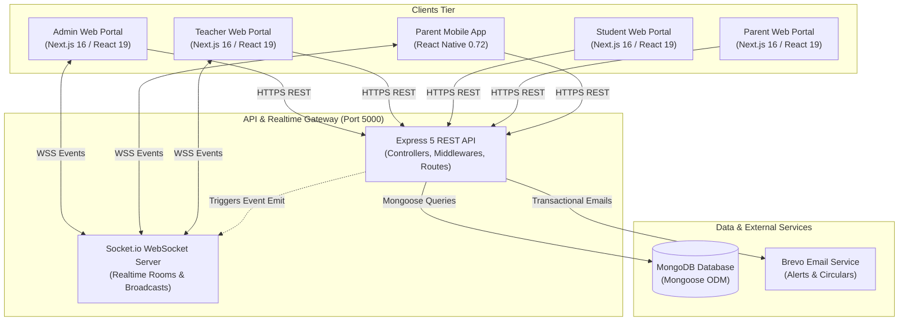
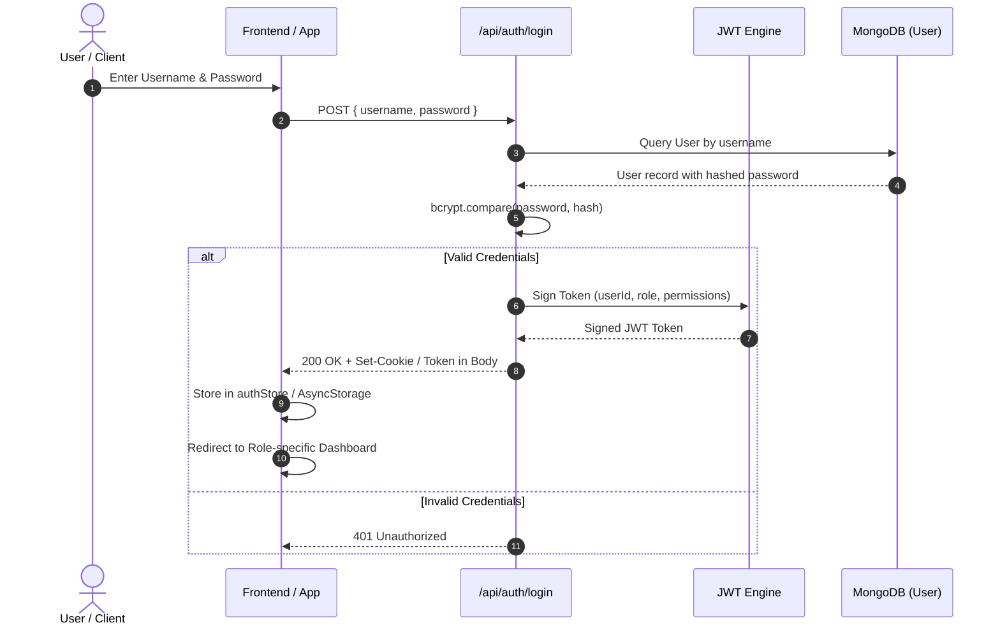

# System Architecture (ARCHITECTURE.md)

This document provides a comprehensive technical overview of the system architecture, component topology, database schemas, authentication lifecycle, and real-time communication protocols for the **Aathithiya School ERP**.

---

## 1. High-Level System Architecture

The ecosystem consists of three major tiers:
1. **Clients Tier**: Responsive Next.js 16 Web Applications (Admin, Teacher, Student, Parent) and a React Native Parent Mobile App.
2. **API & Realtime Tier**: Node.js/Express 5 REST API gateway and a Socket.io WebSocket server.
3. **Data Tier**: MongoDB document database (with Mongoose ODM) and MongoDB Atlas / in-memory server for development.



---

## 2. Authentication & Authorization (RBAC)

### 2.1 Auth Flow


### 2.2 Roles & Permissions Matrix
- **`SUPER_ADMIN`**: Unrestricted access to system settings, finance, academic setups, user creation, data recovery, and audit logs.
- **`SUB_ADMIN`**: Granular delegated roles (configured via `Role` collection) for office clerks, accountants, or librarians.
- **`TEACHER`**: Access to assigned classes, subject attendance marking, homework creation, grading, and syllabus uploads.
- **`STUDENT`**: Read access to timetable, attendance summaries, homework assignments, exam schedules, and library records.
- **`PARENT`**: Child monitoring dashboard, fee payment portal, bus/transport live tracking, and leave application submissions.

---

## 3. Database Schema & Entity Relationships

The data model is built in MongoDB using Mongoose schemas. Core entities and their relationships are mapped below:

```mermaid
erDiagram
    User ||--o| StudentProfile : "has student details"
    User ||--o| StaffProfile : "has staff details"
    User ||--o{ Role : "assigned custom permissions"

    Class ||--|{ Batch : "contains sections/batches"
    Class ||--|{ Subject : "has academic curriculum"
    
    StudentProfile }|--|| Class : "enrolled in"
    StudentProfile }|--|| Batch : "assigned to"
    StudentProfile ||--o{ FeeRecord : "billed fee items"
    StudentProfile ||--o{ Attendance : "attendance records"
    StudentProfile ||--o{ ExamResult : "academic grades"
    StudentProfile ||--o{ GatePass : "gate passes issued"

    StaffProfile }|--|{ Class : "teaches in"
    StaffProfile ||--o{ Timetable : "scheduled slots"

    FeeRecord ||--|{ IPaymentTransaction : "contains payment transactions"

    Exam ||--|{ ExamResult : "graded marks"
    Exam }|--|| Class : "scheduled for"

    Transport ||--o{ TransportLog : "daily trip logs"
    Transport ||--o{ StudentProfile : "assigned bus route"

    HostelRoom ||--o{ StudentProfile : "room occupants"

    LibraryBook ||--o{ LibraryIssue : "borrow transactions"
    StudentProfile ||--o{ LibraryIssue : "borrowed by"
```

---

## 4. Real-Time Communication Architecture (Socket.io)

Socket.io enables bidirectional communication between the server, web portals, and mobile app.

### 4.1 Room Architecture
- `school`: Global announcement channel for all connected users.
- `role_<ROLE_NAME>`: Channel for role-specific broadcasts (e.g., `role_TEACHER`, `role_PARENT`).
- `class_<CLASS_ID>_<BATCH_ID>`: Class-specific notifications (attendance marked, homework posted).
- `parent_<STUDENT_ID>`: Direct line to parent for child check-in, gate pass approval, or bus arrival alerts.

### 4.2 Key Real-Time Events
| Event Name | Direction | Payload | Description |
| :--- | :--- | :--- | :--- |
| `join_room` | Client ➔ Server | `{ room: string }` | Subscribes socket client to a room |
| `notification` | Server ➔ Client | `{ title, message, type }` | In-app notification toast |
| `attendance_alert` | Server ➔ Client | `{ studentId, status, date }` | Real-time absent/late alert to parent |
| `gatepass_update` | Server ➔ Client | `{ passId, status, studentName }` | Gate security or parent pass approval |
| `transport_ping` | Server ➔ Client | `{ vehicleId, lat, lng, speed }` | Bus route tracking coordinates |

---

## 5. Frontend Architecture (`frontend/`)

The web client follows Next.js App Router conventions with an Atomic Design component structure:

```
frontend/src/
├── app/                        # App Router Pages & Layouts
│   ├── (auth)/login/           # Public Auth
│   ├── admin/                  # Administrative Management Dashboards
│   ├── teacher/                # Faculty Workflows & Grading
│   ├── student/                # Student Learning Portal
│   └── parent/                 # Parent Oversight Portal
├── components/                 # Atomic UI Components
│   ├── atoms/                  # Buttons, Badges, Inputs, Spinners
│   ├── molecules/              # Form Fields, Search Bars, Stat Cards
│   ├── organisms/              # Data Tables, Modal Dialogs, Navbars, Sidebars
│   └── templates/              # Dashboard layouts, Report card prints
├── hooks/                      # Custom hooks (useAuth, useApi, useSocket)
├── lib/                        # Axios instance, exportUtils (PDF/Excel), validations
├── store/                      # Zustand store (authStore)
└── types/                      # Shared TypeScript DTOs and interfaces
```

---

## 6. Mobile Application Architecture (`parent-app/`)

The mobile client is built on React Native 0.72 targeting Android and iOS:

```
parent-app/src/
├── config/                     # Axios API base configuration (api.ts)
├── context/                    # AuthContext (token storage) & SocketContext
├── navigation/                 # RootNavigator with BottomTabNavigator & Stack
│   ├── DashboardScreen         # Overview, attendance summary, circulars
│   ├── AttendanceScreen        # Calendar view of student attendance
│   ├── AcademicScreen          # Timetable, subjects, homework
│   ├── FeesScreen              # Fee dues, payment history, receipts
│   └── ProfileScreen           # Student demographic info & settings
```
